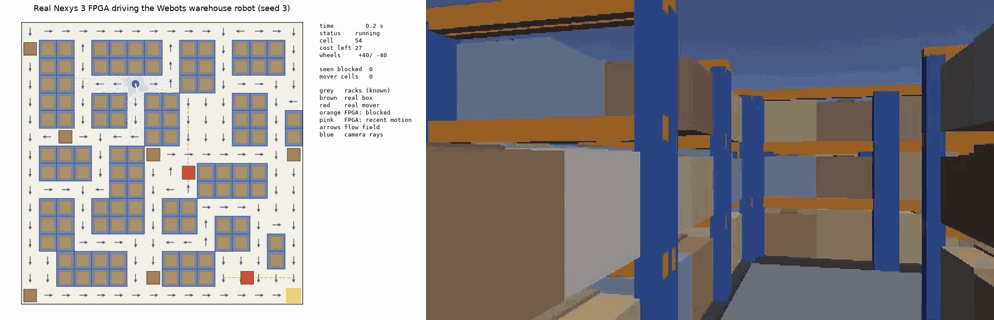

1. this list will be replaced by the toc
{:toc .large-only}

## Flow-field based routing algorithms for efficient PCB design automation
MS Research · 2024–2026 · KFUPM · Supervisor: Dr. Jhonathan Prieto Rojas
{:.faded}

A scalable, multilayer autorouting framework that uses cost propagation and vector fields to guide connections through complex boards. As printed circuit boards grow denser, routes must satisfy geometric constraints while balancing runtime, wirelength, and the cost of changing layers. I developed a 3D framework combining Dijkstra propagation, vector-field guidance, and via-aware costs, and integrated a U-Net model trained on the PCBench dataset to predict promising routing regions. Implemented and evaluated in Python and C++, the framework showed improved runtime efficiency and competitive routing performance on large PCB benchmarks, as described in my [CV](/assets/Asrafuzzaman-Khan-Nahin-CV.pdf).

*EDA · Pathfinding · Machine learning · Python & C++*

## High-efficiency gold bottom reflector grating coupler
BSc Research · 2022–2023 · Islamic University of Technology
{:.faded}

Exploring uneven grating geometry to couple more light into an integrated photonic device. Efficiently coupling light into photonic structures requires careful control of geometry and optical behavior, so I used ANSYS simulation tools to explore and optimize a gold bottom reflector grating coupler with uneven grating features. The optimized design increased modeled coupling efficiency from 67% to 89.5%.

*Photonics · Simulation · Optimization · ANSYS*

## FPGA Dynamic Robot Path Planner
{:.proj-title tabindex="0"}

  <dl>
    <dt>Type</dt><dd>Personal project</dd>
    <dt>Tools</dt><dd>Verilog, Xilinx ISE, Icarus Verilog, Python, Webots</dd>
    <dt>Board</dt><dd>Digilent Nexys 3 (Spartan-6 XC6SLX16)</dd>
    <dt>Code</dt><dd><a href="https://github.com/aknahin/fpga-dynamic-robot-path-planner" class="external">aknahin/fpga-dynamic-robot-path-planner</a></dd>
    <dt>Demo</dt><dd><a href="https://youtu.be/R98e_o1Yoh4" class="external">YouTube</a></dd>
  </dl>
  
A Nexys 3 FPGA does all the thinking for a robot simulated in Webots. The robot starts at a random spot in a maze-like warehouse and must reach the delivery zone. It is only told where the shelving racks are. It finds boxes and moving carts itself from four small depth cameras, and the FPGA decides which obstacles are moving. Every 32 ms frame the FPGA rebuilds a cost field and a flow field and sends back the wheel speeds over Ethernet. The Mac only passes bytes and runs the simulator.

  
The design fits in 30% of the chip at 100 MHz and matches a Python reference model bit for bit on every frame. On the real board it needs at most 0.37 ms of compute per frame, and the robot reached the goal in all 60 random warehouses. An earlier version used BFS on an 8×8 grid and replanned when an obstacle blocked the route.

  <figure>
    
    <figcaption>Seed 3, real board in the loop, 3× speed. Left: what the FPGA believed. Right: the robot's view.</figcaption>
  </figure>
  
Arrows: flow field · Orange: cells the FPGA thinks are blocked · Red: real carts

Personal project · 2026 · Verilog, Nexys 3, Webots
{:.faded}

Built a flow-field planner in Verilog that drives a simulated warehouse robot from a real FPGA. It finds moving obstacles from depth cameras and replans every 32 ms. Code on [GitHub](https://github.com/aknahin/fpga-dynamic-robot-path-planner).

*FPGA · Path planning · Flow field · Verilog · Nexys 3 · Webots*

## Collaborate
Have a research question in mind? I'm interested in new problems across intelligent engineering systems and autonomous planning. [Start a conversation](/contact/).
